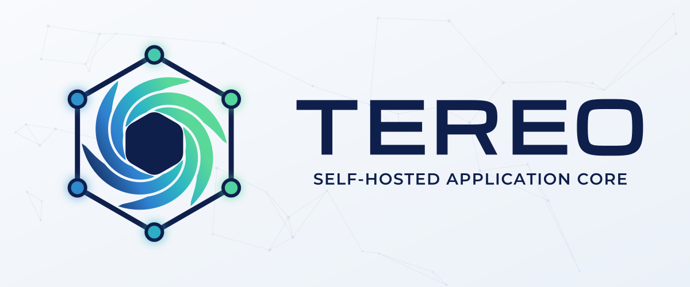

<p align="center">
  
</p>

# Tereo

**τηρέω** — *to keep, to watch over.*

A reusable application core — OAuth2/OIDC authentication, virtual file storage, webhook delivery,
and centralized audit logging — so any new app can start from a working foundation instead of
rebuilding one.

**Deployed once per app, not as a shared instance.** Each consuming app runs its own core — one
service, one database, its own signing keys, admin user, and buckets. The container image is shared;
configuration is not.

## Packages

| Package | Description |
|---------|-------------|
| `tereo` | **The service** — auth (OAuth2/OIDC), file storage, webhook delivery and audit logging in one process, port 4001 |
| `tereo-ui` | The admin UI (Vite + React): auth admin and My Account, file storage, webhooks and the audit log, talking to core directly. Ships in core's image and is served by core at `/`; port 4000 in development |
| `@tereo-io/sdk` | The SDK app services use to reach core: `createCoreClient` gives `auth`, `files`, `webhooks` and `audit` over the service's one set of credentials. its types describe the service's provisioning document, and `core.outbox` writes audit entries and events in the app's own transactions |

## Getting started

You need **Docker** (with Compose v2) for every path below, and **Node.js 22** with npm for local
development. Clone the repo and work from its root.

### 1. Run it with Docker

```sh
docker compose up -d --build
```

This builds one image (core plus the admin UI), starts Postgres and Redis, runs the `migrate`
service (migrations and seed), then starts core on http://localhost:4001. Nothing needs configuring
first: core generates its keys on first start and stores them in the database. The first build
takes a few minutes.

```sh
curl http://localhost:4001/health        # {"status":"ok",...} once core is up
```

Host ports default to 4001 (core), 5442 (Postgres) and 6389 (Redis); set `CORE_PORT`,
`CORE_POSTGRES_PORT` or `CORE_REDIS_PORT` to move them, and use your `CORE_PORT` wherever a URL
below says 4001. Postgres and Redis listen on 127.0.0.1 only. After pulling new code, run the same command again: `--build` rebuilds the image
and `migrate` applies any new migrations.

### 2. Create the first admin

Until an admin exists, core logs a one-time setup token on every start:

```sh
docker compose logs core | grep "not set up"
# Core is not set up. Complete setup at http://localhost:4001/setup with this token: 7QK4-M2XD-9PWA
```

Open **http://localhost:4001/setup**, enter the token, and create your admin account (a password
of 12 or more characters, with an uppercase and a lowercase letter, a digit and a symbol) and your
organization. Then sign in at **http://localhost:4001**. The API reference is at
**http://localhost:4001/docs**.

The token is valid for 24 hours; restarting core (`docker compose restart core`) logs a new one, so
the `grep` may show several — any unexpired one works. Setup can also be done with the API:

```sh
curl -X POST http://localhost:4001/v1/setup -H 'Content-Type: application/json' -d '{
  "token": "7QK4-M2XD-9PWA",
  "admin": { "email": "you@example.com", "name": "You", "password": "Choose-a-long-one-1" },
  "organization": { "name": "Acme", "slug": "acme", "code": "ACME" }
}'
```

`GET /v1/setup/status` says whether setup is done; `POST /v1/setup` is a 404 afterwards.

To start over with an empty database, `docker compose down -v` deletes the stack's data — the
database, its generated keys and every stored file — and the next `up` waits for setup again.

### 3. Develop locally

Core and the admin UI run on your machine with hot reload; Postgres and Redis run in Docker.

```sh
npm install
docker compose up -d postgres redis                    # host ports 5442 / 6389
cp packages/tereo/.env.example packages/tereo/.env
cd packages/tereo
npx prisma generate                                    # before any build or type-check
npx prisma migrate deploy && npx tsx src/scripts/seed.ts
npm run dev                                            # core on http://localhost:4001
```

Stop the Docker `core` container first if it is running (`docker compose stop core`): both use port
4001. Local core uses the same database as the Docker stack, so an admin created in step 2 carries
over. On an empty database core logs its setup token in this terminal instead; complete setup as in
step 2, at http://localhost:4000/setup once the UI is running.

If the default ports are taken, point `.env`'s `DATABASE_URL` and `REDIS_URL` at your
`CORE_POSTGRES_PORT` / `CORE_REDIS_PORT`, and set `PORT` and `PUBLIC_URL` there too (e.g. `4011`
and `http://localhost:4011`).

The admin UI, in a second terminal from the repo root:

```sh
cp packages/tereo-ui/.env.example packages/tereo-ui/.env.development.local
npm run dev -w tereo-ui                      # http://localhost:4000
```

Core's `.env` already points `UI_BASE_URL` at :4000, so logins, CORS and redirects work between the
two. The dev server will not fall back to
another port; to move it, run `npm run dev -w tereo-ui -- --port 4013`, set core's
`UI_BASE_URL` to match, and point `VITE_CORE_URL` in `.env.development.local` at core.

The Docker core and a local one can share the database: outside production each adds its own UI
callback to the login client and keeps the other's localhost callbacks, so both UIs log in.

**Tests.** The suite starts its own server on port 4001 and uses a separate `core_test` database and
Redis db 1, so stop `npm run dev` first. From the repo root:

```sh
npm run test:local -w tereo                  # against your local Postgres and Redis
docker/test/run.sh                                     # or: throwaway Docker stacks, one per shard
npx nx run @tereo-io/sdk:test                    # the SDK's own tests
npm run e2e                                            # browser workflows: UI + core on :4501 (packages/tereo-e2e)
```

**Before committing**, run what CI runs ([docs/code-style.md](docs/code-style.md)):

```sh
npm run format && npm run sort-imports && npm run lint && npm run check
npm run openapi:build -w tereo               # after changing the OpenAPI spec
```

A change to `@tereo-io/sdk`, `tereo` or `tereo-ui` also needs a version plan (`npm run version-plan`).
The admin UI's components come from [`@kosmeo-ui/react`](https://github.com/kosmeo-ui/kosmeo-ui); library changes go there.

### 4. Add an app service

An app reaches core through [`@tereo-io/sdk`](packages/tereo-sdk/README.md) with its
own client credentials, and what it owns is declared in a JSON provisioning document:

1. Write the app's document (`version` plus `service`), with a slug such as `product-service` and the
   namespace `product`, which prefixes everything it declares. List the roles it needs under
   `access.roles` and name the environment variable holding its client secret in `secretFrom`.
   The SDK's types let the app's build generate the file from typed TypeScript.
2. Put it in the folder `PROVISIONING_PATH` points at, give core the secret
   (`npm run cli -- generate-secret`) under the variable's name, and apply it: restart core, or
   run `npm run cli -- provision` (`--dry-run` first to check the set).
3. Give the app its environment: `CORE_URL` (core's base URL), `CORE_CLIENT_ID` (the service's
   client ID), `CORE_CLIENT_SECRET` (the same secret) and `REQUEST_HANDLER_KEY` (32+ characters of
   your own). `LOG_LEVEL` (default `info`) and `SERVICE_NAME` (the label on the SDK's log lines) are
   optional.
4. In the app, create the client; nothing is registered at boot:

   ```ts
   import { createCoreClient } from "@tereo-io/sdk";

   // redis: an ioredis client with { maxRetriesPerRequest: null }
   const core = createCoreClient({ service: "product-service", redis }); // reads CORE_URL, CORE_CLIENT_ID, …
   await core.start();
   ```

(`POST /v1/admin/services` or **Services → Add Service** in the admin UI still makes a service
that declares nothing, for integrations.)
[packages/tereo/docs/provisioning.md](packages/tereo/docs/provisioning.md) covers the documents in
full, and [registry.md](packages/tereo/docs/registry.md) what a declaration holds.

### 5. Deploy to production

On Kubernetes, install the Helm chart, released with the image at the same version:
`oci://ghcr.io/tereo-io/charts/tereo`. [charts/tereo](charts/tereo/README.md) covers the Secret
it reads and its values; it runs migrations as a hook and refuses a configuration core would.

Elsewhere, run the published image, `ghcr.io/tereo-io/tereo` (amd64 and arm64), pinned to a release such as
`0.1.0`, with `NODE_ENV=production`, the image's default. Core refuses to start without:

| Variable | Notes |
|----------|-------|
| `DATABASE_URL`, `REDIS_URL` | Postgres and Redis (or `REDIS_SENTINELS` + `REDIS_MASTER_NAME`) |
| `PUBLIC_URL` | Core's public `https://` URL, not localhost. The admin UI is served at `PUBLIC_URL`, core's API under `${PUBLIC_URL}/v1` |
| `CORS_ALLOWED_ORIGINS` | Browser origins allowed to call core; `*` is refused |
| `TRUST_PROXY` | The proxies in front of core (`1`, a CIDR list), or `false` when there are none; `true` is refused |
| `CORE_KEK` | `openssl rand -base64 32`. Encrypts the keys core stores; keep it in a secret manager — the stored keys cannot be read without it |

It also refuses `COOKIE_SECURE=false` and a `UI_BASE_URL` that is not `https://`. Give
`FILE_SERVICE_STORAGE_PATH` (the image uses `/app/storage`) a persistent volume too.

Run migrations before core starts, with the same environment: the image's
`./migrate-and-seed.sh` (from `docker/`, in the image's working directory) applies them and runs the
idempotent seed:

```sh
docker run --rm --env-file core.env ghcr.io/tereo-io/tereo:0.1.0 ./migrate-and-seed.sh
```

Run it again with each new release's image before starting that release.

The first start logs a setup token, as JSON from the `api` or `all` process; complete setup at
`${PUBLIC_URL}/setup` as in step 2. In production, set `SETUP_TOKEN` instead (24+
characters, from your secret manager): core accepts that value and never logs a token, so none
reaches shipped logs. `ROLE=api` and
`ROLE=worker` split HTTP from the background workers; at least one process must run `all` or
`worker`, or webhooks are never delivered. Health checks are `GET /health` on `PORT` (4001) for
`api` and `all`, and on `WORKER_HEALTH_PORT` (4002) for `worker`.

Every setting is in [packages/tereo/docs/configuration.md](packages/tereo/docs/configuration.md);
the error codes the API returns are in [packages/tereo/docs/errors.md](packages/tereo/docs/errors.md).
Notifications (email connections, sending, delivery) are in [packages/tereo/docs/notifications.md](packages/tereo/docs/notifications.md).

### Troubleshooting

| Symptom | Fix |
|---------|-----|
| `EADDRINUSE` on 4001 | The Docker `core` container and `npm run dev` (or the test suite) both use 4001; stop one |
| `Port 4000 is already in use` from the UI | Free it, or move the dev server as in step 3 |
| Lost the setup token | Restart core; it logs a new one while setup is pending. With `SETUP_TOKEN` set, core never logs it: use the value you set |
| Core exits with `Invalid provisioning` | It lists every problem, naming the file and the variable or entry; see [provisioning](packages/tereo/docs/provisioning.md) |
| UI login fails with `Invalid redirect URI` | Core's `UI_BASE_URL` must match where the UI runs (:4000 for `npm run dev`, `:4001` for the built UI); restart core after changing it |
| `Cannot find module '…/prisma/generated/client/index.js'` | `npx prisma generate` in `packages/tereo` |
| Core exits with a configuration error | The message names the variable; see [configuration](packages/tereo/docs/configuration.md) |

## How the UI is served

In the image, core serves the UI's production build (`npm run build -w tereo-ui`, base
`/`) from `UI_DIST_PATH`, by default `packages/tereo-ui/dist`, at its root. Core's own API is
under `/v1`; `/oauth`, `/.well-known`, `/health`, `/ws` and `/assets` are core's too, and every other
browser path gets the UI (`npm run check` in the UI refuses a route under one of those). The build calls core on its own origin. The UI's API docs page (`/docs`) renders core's
bundled spec with Redoc; the UI's `dev` and `build` first run `openapi:sync`, which copies
`packages/tereo/openapi/bundled-openapi.yaml` into its `public/openapi/` (gitignored). The
UI logs in through the client core seeds under the fixed id `tereo-ui`; its redirect URIs
are set from `UI_BASE_URL` on every start (in production that one callback replaces the list).

## Current state

**What works:** one process and one database, with in-process calls between auth, files,
webhooks, audit and notifications. Every actor and organization column is a foreign key into
`auth`, and users and organizations are deactivated rather than deleted. `docker compose up` on a
clean checkout builds, migrates, generates keys and waits for setup. App services are
declared by provisioning documents: permissions, roles, buckets, event types, access and webhook
subscriptions, applied at start; what a document drops is retired. They reach core through
`@tereo-io/sdk` — one client, the document types, and a transactional outbox. The admin UI, `tereo-ui`, ships in
core's image with setup, services, auth admin, files, webhooks, notifications, the audit log and
API docs.
A deploy declares its services, login clients and custom roles in a folder of JSON
[provisioning documents](packages/tereo/docs/provisioning.md) that core validates as one set and
applies at every start and with `npm run cli -- provision`, with secrets from the environment and
access granted by the documents, and
`SETUP_TOKEN` lets first-boot setup run unattended. Login clients carry an admin-set `audience` and a
`consentRequired` flag (a provisioned client can also trust named core scopes to skip consent), and
app service secrets share one `tereo_sk_` format. Machine clients for external parties are
[integrations](packages/tereo/docs/integrations.md), org-bound or platform, declared in provisioning
or made in the admin UI; they manage their own webhook endpoints and receive events addressed to
them (`recipients`). A service can reach its own webhooks at a private address with
`internalHost`. Permitted staff can sign in into any active organization
([support access](packages/tereo/docs/auth.md#support-access)), and an app can offer an
organization picker with the `core:organizations` scope.
CI checks formatting, import order, lint and types, runs the suite in Docker with real users and
tokens, and starts the release image against a fresh database.

**Releases.** Core's image is published as `ghcr.io/tereo-io/tereo` and the SDK as `@tereo-io/sdk`,
each with its own version (see [Releases](docs/code-style.md#releases)). Before 1.0, a minor
release (0.1 → 0.2) may change the API, the SDK or the configuration; each package's
`CHANGELOG.md` says what changed.

**What is not done yet**, in order:

| # | Gap | Notes |
|---|-----|-------|
| 1 | **Object storage** | Files are on local disk (`FILE_SERVICE_STORAGE_PATH`), so every core process must share one volume, and core cannot scale out, until an S3 backend exists |
